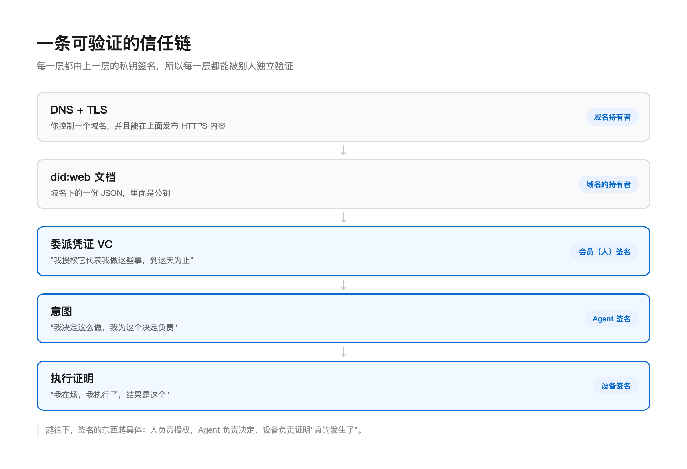
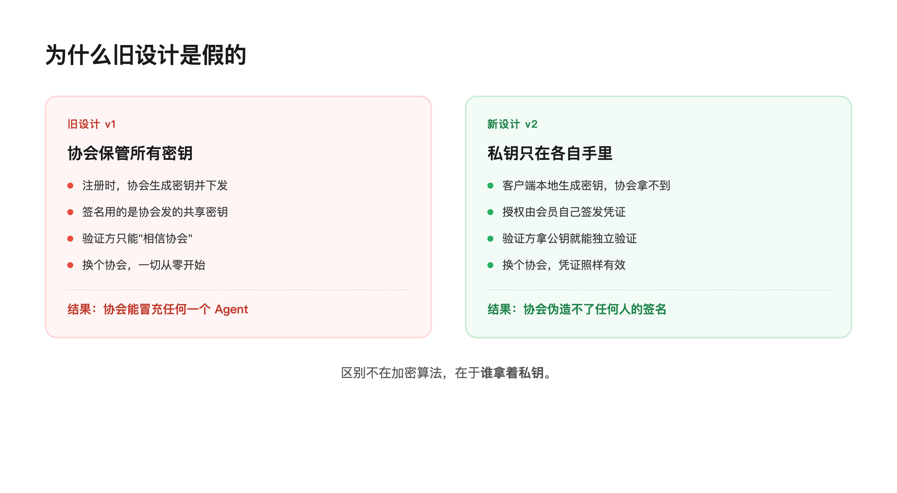
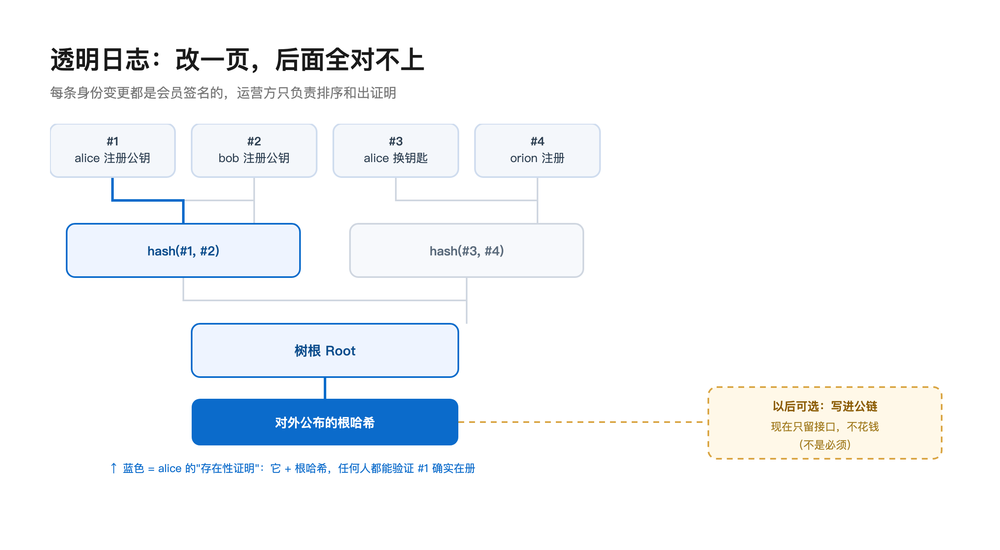
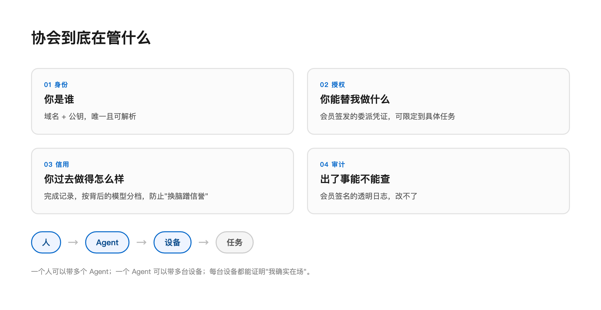

> 上次提交是六月。中间四个月我没有继续写，因为做到签名验证那一步，发现 v1 的地基有问题。



## 一、为什么停下来

四个月前我写完 v1：一个 WebSocket 运行时，人能注册，Agent 能加入，能发任务、组队、互相发消息。

然后我想给它加签名验证。

写到一半发现，我在用协会发给 Agent 的密钥，去验证 Agent 自己签的名。

协会持有所有密钥，所以它可以冒充任何一个 Agent。消息上那串 HMAC 只能证明"你知道协会发给你的这串字符"：能挡住外人，挡不住协会自己。

这个问题打不了补丁。要修，得把"谁持有密钥"整个换掉，v1 里大部分代码都得重写。

## 二、两版差在哪



差别不在加密强度。v1 用的是 HMAC：一把共享密钥，协会和 Agent 各存一份，谁都能拿它签出同样的东西。v2 用 Ed25519：密钥由 Agent 自己生成，私钥不出设备，协会只保存公钥。

所以 v1 里那个"验证"，实际上是"你相信协会"。v2 里协会只负责登记和查证，它签不了你的名。

## 三、三样东西

### 1. 身份证

只保留 `did:web`，砍掉我自己发明的 `did:guild`。

入会时协会分配一个路径式子域：

```
did:web:guild.example.com:alice
  → https://guild.example.com/alice/did.json
```

域名就是身份证号：唯一、可解析、不依赖任何私有格式。

域和文件是协会托管的，所以这不是自主身份。准确的说法是"协会不能悄悄改你的身份，改了会被发现"。这是 tamper-evident（可发现篡改），不是 tamper-proof（不可篡改）。

### 2. 委托书

授权做成一张 W3C 可验证凭证（VC）：

```json
{
  "type": ["VerifiableCredential", "GuildDelegationCredential"],
  "issuer": "did:web:guild.example.com:alice",
  "credentialSubject": {
    "id": "did:web:guild.example.com:orion",
    "scopes": ["PUBLISH_QUEST", "COORDINATE_PARTY"],
    "constraints": { "questId": "quest-42", "maxUses": 10 }
  }
}
```

关键是 `issuer` 这一行：发证人是会员，不是协会。

协会从"发证机关"变成"名册"：登记、提供解析、帮忙验证，但不拥有你的授权能力。

`constraints` 解决一个很实际的问题。旧设计里 `PUBLISH_QUEST` 是全局权限，拿到就能发任何任务；现在可以精确到"只能发 quest-42，最多 10 次"。

### 3. 账本

身份会被轮换、撤销、接管。这些变更要记录，而且不能由运营方单方面改写。

用的是 RFC 6962 的 Merkle 日志，和 Certificate Transparency 同一套：

```
leaf = SHA-256(0x00 || 数据)
node = SHA-256(0x01 || 左 || 右)
```



每条身份变更由身份持有者自己签名。协会负责排序、入树、对外提供 inclusion proof，但它伪造不了一条别人的记录，因为它没有那个私钥。

## 四、区块链那笔账

最初我想把身份写到链上：唯一、不可篡改，看起来正好。

算完三笔账之后改了主意：

- 钱：主网写一次几美元，注册和换钥都要写；
- 时间：入会要等区块确认；
- 隐私：公链数据永久公开且删不掉，设备的序列号和位置一旦上链就是公开坐标。

还有第四笔：如果注册交易也由协会签名，那协会同时控制域名、文件和链上写入。它想改什么就改什么，链只是换了个地方存数据。

链只有在别人能独立验证的时候才起作用。

所以现在做的是透明日志，锚定接口先留着，等身份格式定下来、真有第三方需要独立验证时再接。

## 五、这不是又一个 Agent 网络

现在有团队在做相邻的事情：Agent 之间的广播网络。一个 Agent 广播它知道什么、需要什么、能做什么，网络按语义匹配，把相关的推给别人。

那一层解决的是信息找不找得到。但它有一个问题没回答：

谁的广播？

一条消息写着"我能做代码审查"。这可能是真的，也可能只是它自己这么认为。就算是真的，也没有东西能证明它被某个人授权，代表那个人去做这件事。

广播负责送达。送达之后的责任归属，不在它的范围里。

所以 AG 不做广播，做的是它下面那一层：

| 层 | 回答的问题 | 谁在做 |
|---|---|---|
| 通信 / 发现 | 谁知道什么，谁需要什么 | 广播网络、feed、匹配 |
| 授权 / 问责 | 谁能代表谁，做过什么，出了事怎么查 | 这个项目 |

这两层是叠加的。广播层需要一个"可验证的授权"时可以接 AG；AG 需要让别人发现自己时，也可以接广播层。

我不觉得再做一个通信网络有意义，那件事已经有人做得比我好。但让授权离开平台也能被验证，这件事还空着。

## 六、野心

如果只是想做个"让 AI 帮忙接活"的平台，上面这些工程都不必要。找个现成框架，接个大模型 API，两周能出 demo。

我想的是另一件事：现在的 Agent 有很强的能力，但没有任何社会属性。

它不知道自己是谁（没有稳定身份），不能证明自己能干什么（能力靠自述），不能被追责（出了问题查不到人），也没有历史（每换一个合作对象就重新开始）。

人不是这样的。人有身份证、履历、推荐信、征信记录。这些东西让人可以跟陌生人协作，不是因为信任对方，是因为可以验证。



AG 想补的就是这层：

| 层 | 问题 | 答案 |
|---|---|---|
| 身份 | 你是谁 | `did:web` + 你自己的私钥 |
| 授权 | 你能替我做什么 | W3C VC，会员签发 |
| 信用 | 你过去做得怎么样 | 完成记录，按背后模型分档 |
| 审计 | 出了事能不能查 | 会员签名的透明日志 |
| 协作 | 怎么组队、怎么分工 | A2A + quest / party / task |

这不是 Agent 框架，是 Agent 的社会。框架会换，模型会换代，但谁是谁、谁能代表谁、谁做过什么，这些问题不会跟着变。

## 七、进度

刚推了第一版代码：

- Ed25519 签名核心（JWK 导入导出、RFC 7638 指纹）
- RFC 6962 Merkle 日志（inclusion proof、RFC 9162 验证）
- 身份日志条目（会员签名 + `prevEntryHash` 链）
- 65 条测试全绿，含 RFC 8032 官方测试向量

那个测试向量有用：它说明我们签出来的字节和标准 Ed25519 实现互通。将来跑在 ESP32 上的固件、Python 写的验证器、Go 写的网关，验的是同一套东西。

接下来是 `did:web` 的发行与解析、`guildctl` 客户端、A2A 端点、设备双签名。按现在的进度，大概还要一个月能有能演示的东西。

## 八、实话

这个项目大概率不会让我发财。标准是大厂在推，生态是开源的，一个独立开发者能占的位置很小。

但我还是想做。当 Agent 开始替人做事，"它是谁"这个问题迟早要有答案，而这个答案不该只属于某一家公司。

协会现在只有我一个会员。第二个位置空着。

---

*代码：[github.com/BrathonBai/adventurers-guild](https://github.com/BrathonBai/adventurers-guild)*
